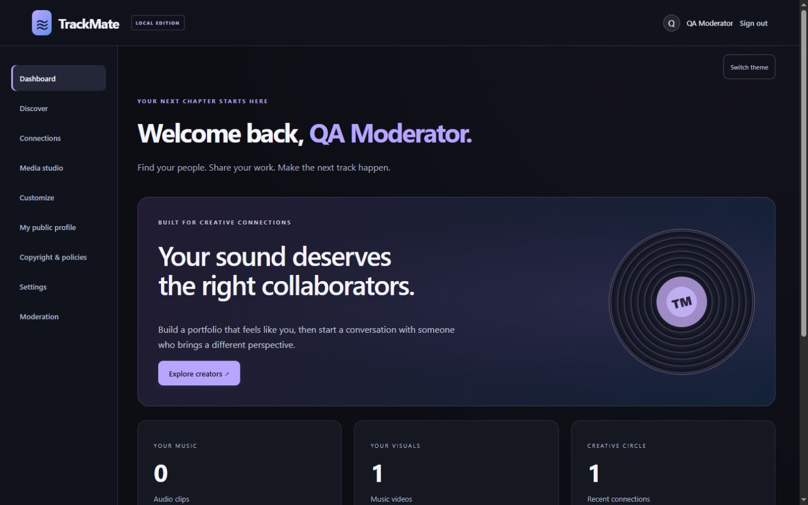
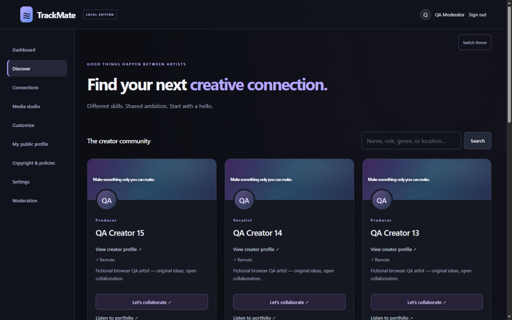
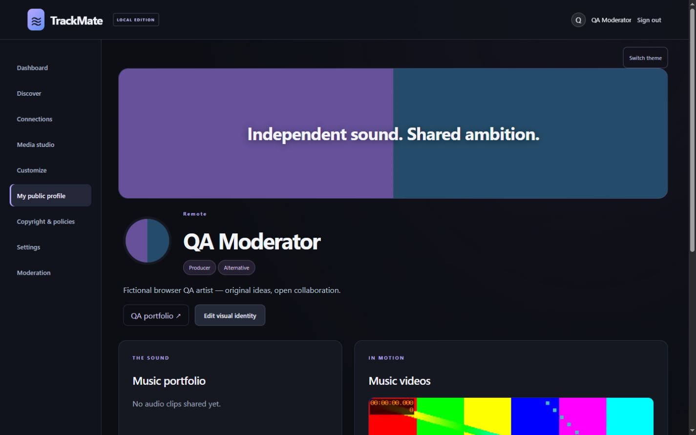
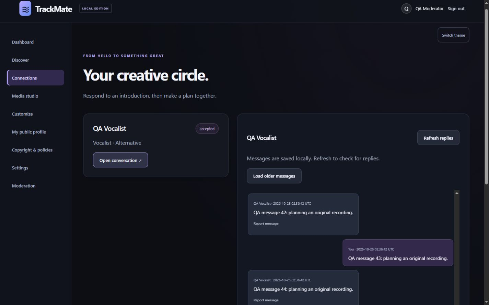
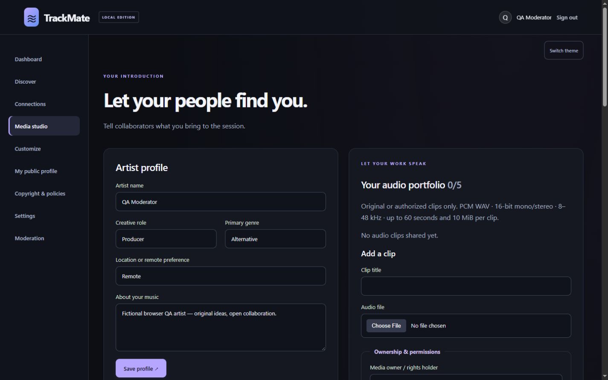
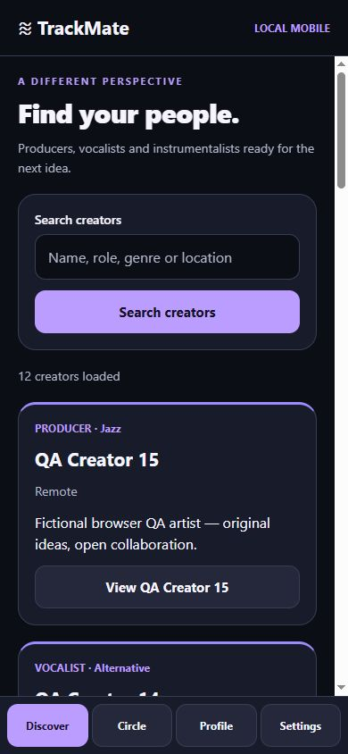

# TrackMate

### Independent creators. Shared sound.

A full-stack music collaboration project that brings creator discovery, personalized portfolios and consent-based messaging into one workspace.

**This repository is a portfolio showcase, containing documentation and selected screenshots only. Application source remains unpublished. TrackMate runs locally; it is not a publicly launched service or an App Store release.**

## The project

Music creators need more than a list of profiles: they need to hear someone's work, understand their creative role and decide whether to start a conversation. TrackMate explores that workflow from discovery through collaboration, with safety and account controls built alongside the core experience.

The application includes a desktop/mobile-responsive website and a focused React Native client that shares its backend. This showcase documents the implemented local project without releasing its source or internal product roadmap.

## Selected capabilities

- **Creator discovery:** search by creative role, genre and location, with paginated results and connection status.
- **Personalized profiles:** avatar/banner uploads, crop previews, banner customization, accent colors, badges and portfolio links.
- **Music portfolios:** validated audio and MP4 uploads, generated video thumbnails and authenticated playback.
- **Consent-based collaboration:** recipient-approved connections and participant-only messaging with paginated history.
- **Account security:** password authentication, TOTP two-factor sign-in, single-use recovery codes and session controls.
- **Community safety:** reporting, blocking, role-based review and account deletion.
- **Mobile client:** focused discovery, profiles, connections, messaging, playback and safety flows using Expo/React Native.

## A look inside

Every image below is an actual capture of locally running software. Names, messages and media are fictional test fixtures—not real users, commercial recordings or production activity.

### Find a creative collaborator

Discovery cards surface each creator's role, genre and portfolio context.

### Build a creative identity

Profiles combine personalized presentation with audio/video work and collaboration controls.

### Start a conversation with consent

An accepted connection opens a private conversation. Replies refresh manually; this project does not claim real-time messaging or end-to-end encryption.

### Manage a music portfolio

The media studio provides upload progress, validation feedback, ownership declarations and portfolio management.

### Explore the mobile experience

The focused client uses React Native components. This image is its **React Native Web browser preview**, not an installed iOS/Android application screenshot.

## Engineering focus

| Area                    | Approach                                                                                   |
| ----------------------- | ------------------------------------------------------------------------------------------ |
| Web interface           | Semantic HTML, responsive CSS and native JavaScript modules                                |
| Mobile interface        | Expo, React Native and TypeScript                                                          |
| Backend and persistence | Node.js HTTP API and SQLite                                                                |
| Access control          | Server-enforced ownership, connection consent, blocking and role separation                |
| Media handling          | Server-side validation, image processing, constrained video processing and bounded storage |
| Reliability             | Transactional migrations, failure-case tests and explicit loading/error states             |
| Verification            | HTTP integration tests, client tests, type checking and browser-based responsive checks    |

An important design decision was to preserve the functioning web/backend architecture while adding a mobile client. Another was to keep production-launch requirements separate from working local features: a passing test suite does not establish operational or legal readiness.

## Verification snapshot

Recorded locally on **October 26, 2026**:

- **68 backend tests passed**, covering authentication, authorization, messaging permissions, uploads, blocking, account deletion and relevant failure cases.
- **7 mobile client/tooling tests passed**, alongside TypeScript checking.
- JavaScript/Hermes bundle exports succeeded for web, iOS and Android.
- Responsive browser checks covered widths from **320 to 1440 CSS pixels**. A 49-capture mobile-client matrix found no measured horizontal overflow or undersized visible custom controls under its recorded checks.
- A migration test against a private copy of existing local data preserved record counts and passed database integrity checks.

These are local results, not hosted CI results or an independent security/accessibility certification. Native signing, installation, physical-device behavior and store acceptance remain unverified. Bundle exports are not equivalent to building and testing a signed IPA/APK.

## Status and scope

The web application is locally functional, and the focused mobile client is under development. Production infrastructure, further security testing, physical-device testing and qualified legal review are required before a real-user launch. No public account registration, hosted demo or App Store listing is offered here. Draft legal policies are not represented as approved terms.

The application source, databases, credentials, uploaded files, internal legal documents and detailed roadmap are intentionally excluded. Because this repository contains no runnable application source, there are no installation commands for the application here.

## Development context

TrackMate is part of [Eli's software engineering portfolio](https://github.com/elilovescoding), developed to explore full-stack product engineering. Development included substantial AI-assisted implementation, debugging and review. This showcase does not claim prior independent production experience, real-user adoption or commercial results.

This repository does not grant a license to the unpublished TrackMate application. Third-party technologies retain their respective licenses and trademarks.
